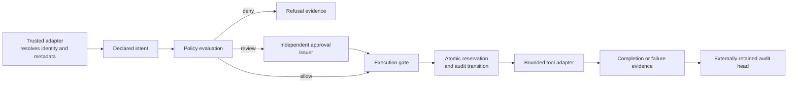

# Agent Governance Kit

**Make an agent's authority inspectable before connecting it to production.**

A working, dependency-free Python reference for evaluating declared tool actions, binding independent approvals, reserving a budget and preserving audit evidence. Accompanied by a synthetic assurance brief and an executive operating model.

> Reference implementation, version 0.1.0. All examples are synthetic. This is not a production authorization service, prompt-injection detector or compliance certification.

## The executive problem

An agent may propose a useful action without having authority to take it. A defensible rollout needs explicit purpose, resource boundaries, decision ownership and evidence of intervention. This project turns that distinction into a small, testable control path.

| Question | Working control | Boundary |
| --- | --- | --- |
| What may the agent do? | Registered tool effects and explicit agent grants | The connector must force every action through the gate |
| Where may it act? | Canonical resource scope, environment grants, classification ceiling | Labels must come from a trusted source in a real integration |
| Who authorizes material impact? | Expiring HMAC approvals bound to the exact request and policy | A trusted signer must authenticate the human first |
| Can it act twice? | SQLite transaction reserves each request once | External side effects are not atomic with SQLite |
| Can we intervene? | Emergency stop prevents new reservations | Already-running callbacks are not cancelled |
| Can we review the decision? | HMAC audit chain, verification and exported head | Tail truncation needs an independently retained head |

## Run in two minutes

Requires Python 3.11 or later. No cloud account, model API, payment or third-party runtime package is needed.

From the repository root, on macOS/Linux:

```sh
PYTHONPATH=src python -m unittest discover -s tests -v
PYTHONPATH=src python -m agent_governance demo --policy examples/policy.json --output reports/local
PYTHONPATH=src python -m agent_governance evaluate --policy examples/policy.json --intent examples/intent.json
```

PowerShell:

```powershell
$env:PYTHONPATH = 'src'
python -m unittest discover -s tests -v
python -m agent_governance demo --policy examples/policy.json --output reports/local
python -m agent_governance evaluate --policy examples/policy.json --intent examples/intent.json
```

The last command returns exit **2** because the sample production change requires review. CLI exit codes: `0` allowed/success, `2` human review, `3` denied, `4` invalid input/error. Evaluation never executes a tool. The demo uses only a fixture callback and a temporary database; it exports JSON evidence and a Markdown executive brief.

Optional installation: `python -m pip install .`, then use `agent-governance` in place of `python -m agent_governance`. Build-time setuptools is required; the installed package has no runtime dependencies.

## What the demo measures

Nine scenarios, generated by the actual gate: three fixture executions complete and six are blocked. The browser portfolio explores these exported receipts; it does not simulate a live approval service.

- Bounded inventory discovery and owner-approved staging work.
- Production change with two independent approval roles.
- Refusal of a production change with only one role.
- Disallowed egress, an unregistered tool and a classification violation.
- Cost limit and emergency stop.
- Each completed request is retried to confirm replay is refused.

Generated results are in [reports/synthetic](reports/synthetic). Request IDs and HMAC keys are generated afresh, so byte-for-byte output varies. The scenario outcomes and policy fingerprint remain deterministic for unchanged inputs.

## Architecture



Read [the threat model](docs/THREAT-MODEL.md), [integration guide](docs/INTEGRATION.md) and [operating model](docs/OPERATING-MODEL.md) before adapting it. The library is synchronous and single-host. It exposes no HTTP server or unrestricted shell executor.

## Review path

1. Read [EXECUTIVE-BRIEF.md](docs/EXECUTIVE-BRIEF.md) and the assurance boundaries.
2. Run the demo and examine the JSON decisions and audit events.
3. Run tests, especially concurrency, approval tampering, expiry, policy change and tail truncation.
4. Read [development decisions](docs/DECISIONS.md) and the residual risks.
5. Treat any real integration as a separately reviewed engineering project.

## References and provenance

The design draws on [NIST AI RMF's four functions](https://airc.nist.gov/airmf-resources/airmf/5-sec-core/), [OWASP's Agentic AI Security guidance](https://genai.owasp.org/2025/12/09/owasp-genai-security-project-releases-top-10-risks-and-mitigations-for-agentic-ai-security/) and [CISA/NCSC secure AI system development guidance](https://www.cisa.gov/news-events/alerts/2023/11/26/cisa-and-uk-ncsc-unveil-joint-guidelines-secure-ai-system-development). See [control mapping](docs/CONTROL-MAPPING.md). These are design references, not an assurance or certification claim.

Code, documentation and synthetic analysis were prepared with **OpenAI Codex assistance** at the portfolio owner's direction. Inclusion in a professional portfolio does not imply that its owner personally coded the implementation or deployed it at an employer. No career achievements, customer endorsements or professional certifications are asserted. See [PROVENANCE.md](PROVENANCE.md).

MIT license. Contributions welcome through scoped issues and reviewed pull requests.
